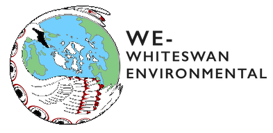

## A partnership with Whiteswan Environmental

  

Through this pilot project, the Institute for Multidisciplinary Ecological Research in the Salish Sea (IMERSS) worked in partnership with the Indigenous-led nonprofit Whiteswan Environmental (WE) to develop digital mapping tools supporting the visualization of ecocultural information and storytelling about natural, cultural, and historical sites in the Salish Sea.

## The Spirit of the Sxwo’le (SOS) Coalition

To ensure appropriate cultural safety protocols were in place, WE initiated the Spirit of the Sxwo’le (SOS) Coalition. It was through this coalition that WE, IMERSS and other Indigenous and non-Indigenous participants came together as a cross-cultural community of practice based on protocols of respect and reciprocity, in support of restoring traditional Indigenous practices and access to place, and of thriving cultures and coastal ecosystems for future generations.

The coalition was organized as follows:

- The SOS Coalition **Leadership Organization Team (LOT)** was 100% Indigenous.
- SOS Coalition **Content Working Groups (CWG)** included Indigenous and non-Indigenous individuals and organizations working on projects in common, such as biodiversity and ecocultural mapping.

IMERSS’ involvement in this coalition was facilitated through the leadership role of Jeannine Georgeson, an Indigenous member of the Galiano community and member of IMERSS, who led the Xetthecum project.

## From Retreat Cove to the wider Salish Sea

Through this pilot project we aimed to develop preliminary tools and resources that might help to facilitate the broader regional work of the SOS Coalition, beginning in the local context of Retreat Cove, Galiano Island, BC.

On the regional scale, that work was held in view of a longer term vision described by members of the coalition: a Coast Salish Tribal Heritage Field Institute of seven longhouses in the San Juan Islands and seven longhouses in the Gulf Islands. Whether and how the methodologies explored through the Xetthecum pilot might serve that vision is not ours to determine, and remains a matter for the coalition and the communities involved.

## Gratitude

We are grateful to the Access to Media Education Society, Capital Regional District, Community Engagement Fellows, Galiano Conservancy Association, Hunterston Farm community, Inclusive Design Research Centre, Indigenous Watersheds Initiative, Islands Trust Council, Southern Gulf Islands Community Resource Centre, MIT Solve Indigenous Communities Fellowship, Northeast Pacific Coastal Biodiversity Action Network, Social Sciences and Humanities Research Council, UBC BRITE Internship Program, and WE for making this work possible.

We also thank our advisors, contributors, partners, Galiano Island community members at xe’xe’tth’uqum, and especially the Elders who contributed to this project.—huy ch q’a sii’em!

{}
Project partners and sponsors.
{}
